<b>▸ OPEN THE PAYLOAD MANIFEST</b> — every project, with links

| Project | What it is |
|---|---|
| [Grassroots](https://github.com/d0lawuyi/Grassroots) | Verified sports venue marketplace: find a field, create a game, split the cost |
| [GIMFiT](https://github.com/d0lawuyi/GIMFIT) | Snap a photo of gym equipment, get exercises, sets/reps and target muscles |
| [Portfolio](https://github.com/d0lawuyi/Potfolio) | Personal site on GitHub Pages, synced to my résumé |

CLOUD · AI ENGINEERING · SOFTWARE — <a href="https://d0lawuyi.github.io/Potfolio/">portfolio</a>

